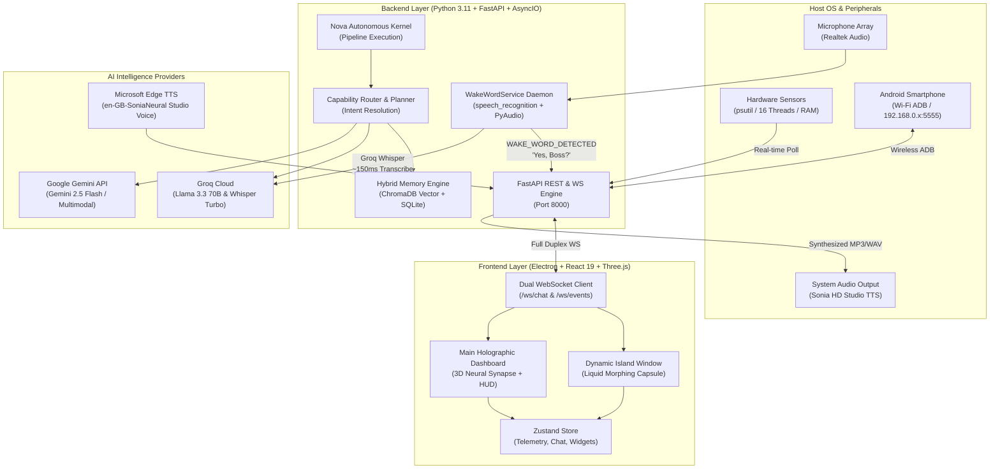
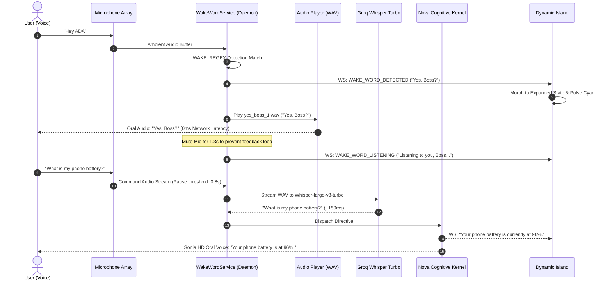

# ADA // Mark VII Autonomous AI Operating System

<div align="center">

```
   █████╗ ██████╗  █████╗     ███╗   ███╗ █████╗ ██████╗ ██╗  ██╗    ██╗   ██╗██╗██╗
  ██╔══██╗██╔══██╗██╔══██╗    ████╗ ████║██╔══██╗██╔══██╗██║ ██╔╝    ██║   ██║██║██║
  ███████║██║  ██║███████║    ██╔████╔██║███████║██████╔╝█████╔╝     ██║   ██║██║██║
  ██╔══██║██║  ██║██╔══██║    ██║╚██╔╝██║██╔══██║██╔══██╗██╔═██╗     ╚██╗ ██╔╝██║██║
  ██║  ██║██████╔╝██║  ██║    ██║ ╚═╝ ██║██║  ██║██║  ██║██║  ██╗     ╚████╔╝ ██║██║
  ╚═╝  ╚═╝╚═════╝ ╚═╝  ╚═╝    ╚═╝     ╚═╝╚═╝  ╚═╝╚═╝  ╚═╝╚═╝  ╚═╝      ╚═══╝  ╚═╝╚═╝
```

**The Next-Generation Desktop-Native Autonomous AI Operating Layer**  
*Cognitive Architecture • Liquid Dynamic Island • Verbal "Hey ADA" Wake Engine • 3D Holographic Neural Interface • Genuine Real-Time Hardware & ADB Telemetry*

---

[](https://python.org)
[](https://fastapi.tiangolo.com)
[](https://www.typescriptlang.org)
[](https://react.dev)
[](https://www.electronjs.org)
[](https://threejs.org)
[](LICENSE)

[Architecture](#system-architecture) • [Dynamic Island](#liquid-dynamic-island) • [Wake Word Engine](#autonomous-hey-ada-verbal-wake-engine) • [Live Telemetry](#100-genuine-real-time-telemetry) • [Desktop & Phone Automation](#cross-platform-automation-matrix) • [Quick Start](#installation--setup) • [Documentation Hub](#master-documentation-index)

</div>

---

## Executive Overview

**ADA Mark VII** (Autonomous Digital Assistant) is an intelligent, privacy-first, desktop-native Operating Layer designed to bridge the chasm between human thought and digital execution. 

Unlike traditional chatbots that remain trapped inside browser tabs, ADA integrates directly with your host operating system and mobile environment:
- **Always-Available Dynamic Island**: A floating, screen-saver level liquid capsule centered at the top of your workspace that expands on hotkeys (<kbd>Alt+Space</kbd> / <kbd>F2</kbd>) or verbal cues.
- **Autonomous Verbal Wake-Word Engine**: Ambient background listener that detects **"Hey ADA"** at the OS level, responds orally with **"Yes, Boss?"** in her signature British Sonia HD studio voice, and captures your spoken directive with **Groq Whisper-large-v3-turbo (~150ms)**.
- **Genuine Hardware & ADB Telemetry**: Zero mocked or randomized metrics. Live monitoring of 16 host CPU threads, physical RAM consumption, and real-time battery status from connected Android devices over Wi-Fi ADB (`dumpsys battery`).
- **Full Automation Matrix**: Native Windows UI controllers (Notepad, Calculator, File Explorer), Playwright headless/headed browser automations, and wireless Android phone control (screen wake, unlock, gesture dispatch, WhatsApp/Instagram messaging).
- **3D Holographic Neural Interface**: Interactive Three.js synaptic neural network with customizable HUD matrix, directive execution streams, and orbital particle physics.

---

## System Architecture

ADA follows a decoupled, high-performance client-server topology combining a **Python 3.11 asynchronous FastAPI/Kernel daemon** with an **Electron / React 19 holographic client** communicating over dual full-duplex WebSockets.



---

## Core Capabilities & Features

### 1. Liquid Dynamic Island
The Dynamic Island floats continuously at the top-center of your primary display across all virtual desktops and full-screen applications.

- **Collapsed State**: Sleek 320×42px glassmorphic capsule displaying live operational status (`ADA • Online`), pulsing microphone, reactive audio waveform, and quick shortcut pill (<kbd>Alt+Space / F2</kbd>).
- **Expanded State**: Spring-physics animation (`stiffness: 410, damping: 32`) morphing to 480×182px, revealing quick action chips (Morning Briefing, Desktop Organizer, Phone Bridge, Deep Web Research) and fluid directive input.
- **Multi-State Reactive Feedback**:
  - `voice-listening`: Concentric sonar rings, glowing cyan microphone pulse, and audio level visualization.
  - `thinking`: Rotating neural circuit indicator with dynamic status message (*"Planning execution..."* / *"Synthesizing briefing..."*).
  - `executing`: Real-time execution step stream.
  - `error`: Subtle rose warning indicator with auto-recovery.

```
+-------------------------------------------------------------------------+
|  [●] ADA • Online        ||||| (Audio Wave)          [Alt+Space / F2]   |
+-------------------------------------------------------------------------+
                                 │  (Alt+Space or "Hey ADA")
                                 ▼
+-------------------------------------------------------------------------+
|  [🎤] LISTENING TO YOU, BOSS...                        17:05            |
|  ─────────────────────────────────────────────────────────────────────  |
|  [ ⚡ Morning Briefing ]  [ 📁 Organize Desktop ]  [ 📱 Phone Bridge ]   |
|  ┌───────────────────────────────────────────────────────────────────┐  |
|  │ Type directive or speak your command...                       [↑] │  |
|  └───────────────────────────────────────────────────────────────────┘  |
+-------------------------------------------------------------------------+
```

---

### 2. Autonomous "Hey ADA" Verbal Wake Engine

ADA features a dedicated, low-latency background audio listener that operates system-wide, even when all windows are minimized or full-screen video games are active.



- **Natural Wake Variations**: Phonetically matches `Hey Ada`, `Ada`, `Hi Ada`, `Hello Ada`, and `Okay Ada`.
- **Pre-Rendered Studio Voice Chimes**: Uses pre-synthesized neural clips ([`yes_boss_1.wav`](backend/voice/wake_responses/yes_boss_1.wav) through [`yes_boss_5.wav`](backend/voice/wake_responses/yes_boss_5.wav)) with `en-GB-SoniaNeural` for zero-delay verbal acknowledgement.
- **Acoustic Self-Muting**: Automatically silences microphone input during speech synthesis to prevent self-triggering feedback loops.
- **Dual Invocation Modes**:
  1. *Two-Step Conversational*: Say *"Hey ADA"* ➔ She replies *"Yes, Boss?"* ➔ Speak your command.
  2. *Single-Breath Directive*: Say *"Hey ADA, check my battery"* ➔ She parses your command directly and executes immediately.

---

### 3. 100% Genuine Real-Time Telemetry

ADA rejects mocked and randomized data. Every metric shown across the HUD and Dynamic Island is collected live from the host operating system and connected hardware:

| Telemetry Component | Metric Source | Verified Specifications |
| :--- | :--- | :--- |
| **Synapse Processor** | `psutil.cpu_percent(percpu=True)` | **16 Logical Threads (10 Physical Cores)**, real-time load bars per thread, **2.40 GHz** clock. |
| **System Memory (RAM)** | `psutil.virtual_memory()` | Physical host RAM (**12.2 / 15.7 GB**, live utilization gauge & nominal health status). |
| **Phone Bridge (ADB)** | `adb shell dumpsys battery` | Live Wi-Fi ADB connection (`192.168.0.101:5555`), real battery level (**96% LINKED**), charging state. |
| **Subsystem Matrix** | Internal Kernel Event Bus | Real-time status for Cognitive Core (`ONLINE`), Desktop Controller (`ARMED`), Voice Wake (`ARMED`), and TTS Engine (`SONIA HD`). |
| **Directive Stream** | `useNovaStore.messages` | Live log stream displaying actual user directives, kernel executions, and assistant responses (zero fake tickers). |

---

### 4. 3D Holographic Neural Interface

Rendered using **Three.js** and **React Three Fiber (@react-three/fiber)**:
- **Holographic Synaptic Sphere**: 150+ dynamic neural vertices connected with pulsing cyan synaptic arcs that morph in real-time based on audio amplitude and processing state.
- **Orbital Synaptic Rings**: Triple nested gyroscope rings rotating with slight counter-phase precession.
- **Ambient HoloDust**: 150 particle holographic dust field with upward drift and additive alpha blending.
- **Audio Visualizer Orb**: Centered glowing core reacting directly to microphone amplitude and TTS playback frequency.

---

### 5. Cross-Platform Automation Matrix

```
                        ┌───────────────────────────────┐
                        │      NOVA CAPABILITY ROUTER   │
                        └──────────────┬────────────────┘
                                       │
         ┌─────────────────────────────┼─────────────────────────────┐
         ▼                             ▼                             ▼
┌──────────────────┐          ┌──────────────────┐          ┌──────────────────┐
│   DESKTOP API    │          │  WEB BROWSER     │          │  ANDROID ADB     │
├──────────────────┤          ├──────────────────┤          ├──────────────────┤
│ • Window Manager │          │ • Playwright     │          │ • Wi-Fi Auto-ADB │
│ • File Explorer  │          │ • Chrome Engine  │          │ • Screen Wake    │
│ • Notepad        │          │ • Multi-Tab Exec │          │ • PIN Unlock     │
│ • Calculator     │          │ • Web Extraction │          │ • WhatsApp Auto  │
│ • Win32 Shell    │          │ • Screenshot OCR │          │ • Instagram Auto │
└──────────────────┘          └──────────────────┘          └──────────────────┘
```

- **Native Windows Controllers**:
  - `FileExplorerController`: Navigate paths, list directories, organize desktop/downloads, batch move files.
  - `NotepadController`: Launch notepad, write notes, save documents with automatic path resolution.
  - `CalculatorController`: Trigger calculations, clear registers, read results.
- **Browser Automation (Playwright)**:
  - Headless and headed chromium execution for automated research, multi-source data extraction, and form interaction.
- **Android ADB Wireless Bridge**:
  - Automated zeroconf / mDNS detection of connected Android devices on local subnet.
  - Automated screen wake, PIN unlock swipe, app launcher (`monkey -p com.whatsapp`), contact search, and message dispatch.

---

## Global Keyboard Shortcuts

| Shortcut | Scope | Description |
| :--- | :--- | :--- |
| <kbd>Alt</kbd> + <kbd>Space</kbd> | Global (System-wide) | Toggle Dynamic Island (Expand / Collapse) |
| <kbd>F2</kbd> | Global (System-wide) | Quick toggle Dynamic Island capsule |
| <kbd>Alt</kbd> + <kbd>D</kbd> | Global (System-wide) | Toggle 3D Holographic Main Dashboard |
| <kbd>F9</kbd> | Global (System-wide) | Quick toggle Main Dashboard window |
| <kbd>Ctrl</kbd> + <kbd>Shift</kbd> + <kbd>Space</kbd> | Global | Secondary shortcut to open Main Dashboard |
| <kbd>Escape</kbd> | Dynamic Island | Collapse Dynamic Island back to pill |
| <kbd>Enter</kbd> | Chat / Directive | Dispatch command to cognitive kernel |

---

## REST & WebSocket API Reference

The backend daemon listens on `http://127.0.0.1:8000` (and `0.0.0.0:8000` for LAN bridges).

### REST Endpoints

| Method | Endpoint | Description |
| :--- | :--- | :--- |
| `GET` | `/health` | Health check verifying kernel and subsystem status. |
| `GET` | `/api/telemetry` | Real hardware telemetry: 16 CPU threads, RAM GB/%, ADB battery, active AI model. |
| `GET/POST`| `/api/tts` | Studio neural voice synthesis (`en-GB-SoniaNeural`) with MP3 stream output. |
| `POST` | `/api/voice/transcribe` | Ultra-fast audio transcription via Groq Whisper-large-v3-turbo (~150ms). |
| `GET` | `/api/voice/wake/status` | Returns active status of the "Hey ADA" background wake word listener. |
| `POST` | `/api/voice/wake/toggle` | Programmatically start or stop the background wake word listener. |
| `GET` | `/api/briefing` | Generates oral and written executive briefing with weather and schedule. |
| `GET` | `/api/devices` | Lists connected wireless ADB Android devices and battery levels. |

### WebSocket Channels

- **`/ws/chat`**: Bidirectional real-time conversational channel. Streams partial assistant tokens, user message confirmations, and completion signals.
- **`/ws/events`**: System-wide telemetry event bus. Broadcasts `WAKE_WORD_DETECTED`, `WAKE_WORD_LISTENING`, `KERNEL_STARTED`, `PLANNING_STARTED`, `STREAM_CHUNK`, and `WORKSPACE_RENDER`.

---

## Installation & Setup

### Prerequisites

1. **Python 3.11+** (Ensure Python is added to Windows PATH)
2. **Node.js 18+** & **npm**
3. **Android Platform Tools (ADB)** (Optional, for phone bridge features)
4. **Git**

### 1. Clone Repository

```bash
git clone https://github.com/Codewithjainam7/Nova.git
cd Nova
```

### 2. Configure Environment Variables

Create a `.env` file in the project root:

```env
# AI Provider API Keys
GROQ_API_KEY=gsk_your_groq_api_key_here
GEMINI_API_KEY=AIzaSy_your_gemini_api_key_here

# Voice & Speech Settings
ADA_VOICE=en-GB-SoniaNeural
PRIMARY_PROVIDER=groq
ACTIVE_MODEL=llama-3.3-70b-versatile

# Security
NOVA_ENCRYPTION_KEY=your_secure_32_byte_key_here
```

### 3. Setup Python Backend Environment

```bash
# Navigate to backend and create virtual environment
cd backend
python -m venv .venv

# Activate virtual environment (Windows PowerShell)
.venv\Scripts\Activate.ps1

# Install core dependencies
pip install -r requirements.txt
pip install speechrecognition pyaudio sounddevice edge-tts psutil av
cd ..
```

### 4. Setup Frontend & Build Production Bundle

```bash
cd frontend
npm install
npm run build
cd ..
```

### 5. Launch ADA Mark VII

To start both the FastAPI backend daemon and the Electron client cleanly:

```bash
# Double-click or run from command prompt:
launch_ada.bat
```

*(Alternatively, to run without a command prompt window, execute `launch_ada_silent.vbs`)*.

---

## Project Structure

```
NOVA_AI/
├── backend/                        # Python 3.11 Cognitive Kernel
│   ├── browser/                    # Playwright Web Automation
│   ├── core/                       # Dependency Injection, Logger, Configuration
│   ├── desktop/                    # Native Windows App Automation Controllers
│   │   └── controllers/            # Notepad, Calculator, Explorer Controllers
│   ├── devices/                    # Wireless Android ADB Bridge & Discovery
│   ├── kernel/                     # Nova Autonomous Kernel & Capability Router
│   ├── memory/                     # ChromaDB Vector Store & SQLite Engine
│   ├── missions/                   # Autonomous Task & Overnight Mission Runner
│   ├── planner/                    # Hierarchical Task Decomposition Engine
│   ├── proactive/                  # Dynamic Briefing Engine
│   ├── providers/                  # Groq, Gemini & OpenRouter Adapters
│   ├── search/                     # Deep Web Research Engine
│   ├── voice/                      # Audio I/O, Studio TTS, Wake Word Engine
│   │   ├── wake_responses/         # Pre-rendered Sonia HD Verbal Audio Clips
│   │   └── wake_word.py            # Autonomous "Hey ADA" Background Listener
│   └── main.py                     # FastAPI Application, WebSockets & REST Routes
│
├── frontend/                       # React 19 + Electron Holographic Client
│   ├── electron/                   # Electron Main & Preload Scripts
│   │   ├── main.cjs                # Window Manager (Dashboard & Dynamic Island)
│   │   └── preload.cjs             # IPC Security Bridge
│   ├── public/                     # Static Assets & Cybernetic Audio Chimes
│   │   └── sounds/                 # wake.wav, startup.wav, wake_responses/
│   ├── src/
│   │   ├── components/
│   │   │   ├── Brain/              # 3D Holographic Neural Scene & SystemHUD
│   │   │   ├── DynamicIsland.tsx   # Screen-Top Floating Liquid Capsule
│   │   │   ├── HUD/                # Startup, Workspace & Customizer Modals
│   │   │   └── Voice/              # Voice Controller & Directives Bar
│   │   ├── contexts/               # Dual WebSocket Connection Providers
│   │   ├── hooks/                  # Voice Recognition & Gesture Hooks
│   │   └── store/                  # Zustand Global Store (useNovaStore)
│   └── vite.config.ts              # Vite Bundler Configuration
│
├── docs/                           # Master Documentation Hub (Chapters 01 - 35)
│   ├── manual/                     # 35-Chapter Comprehensive Operating Manual
│   ├── architecture/               # Subsystem Architecture Specifications
│   └── release/                    # Deployment & Production Checklists
│
├── launch_ada.bat                  # One-Click Unified Launcher (Backend + Electron)
├── launch_ada_silent.vbs           # Background Launcher (No Console Window)
└── README.md                       # Master Architecture & Operating Documentation
```

---

## Master Documentation Index

For in-depth architectural deep-dives, developer manuals, and API specifications, consult the 35 master documentation chapters located in [`docs/manual/`](docs/manual/):

- **[Chapter 01: Getting Started & Installation Guide](docs/manual/01_GETTING_STARTED.md)**
- **[Chapter 02: System Architecture Overview](docs/manual/02_ARCHITECTURE_OVERVIEW.md)**
- **[Chapter 03: Autonomous Kernel Subsystem](docs/manual/03_AUTONOMOUS_KERNEL.md)**
- **[Chapter 06: Desktop Automation Engine](docs/manual/06_DESKTOP_AUTOMATION_ENGINE.md)**
- **[Chapter 10: Speech Recognition (STT) Subsystem](docs/manual/10_SPEECH_RECOGNITION_STT.md)**
- **[Chapter 11: Text-to-Speech (TTS) Subsystem](docs/manual/11_TEXT_TO_SPEECH_TTS.md)**
- **[Chapter 17: Wireless Android ADB Integration](docs/manual/17_ANDROID_ADB_INTEGRATION.md)**
- **[Chapter 20: 3D Neural Brain Canvas (Three.js)](docs/manual/20_3D_NEURAL_BRAIN_CANVAS.md)**
- **[Chapter 21: Holographic HUD & Dynamic Island](docs/manual/21_HOLOGRAPHIC_HUD_AND_UI_COMPONENTS.md)**
- **[Chapter 24: REST & WebSocket API Reference](docs/manual/24_REST_API_REFERENCE.md)**
- **[Chapter 35: Master Navigation Hub](docs/manual/README.md)**

---

## Security & Privacy Constitution

- **Local Execution First**: Hardware telemetry, desktop automation, and memory retention operate entirely on-device.
- **Credential Protection**: All API keys, environment credentials, and device pins are isolated via `.env` and strictly excluded from version control.
- **Explicit Permissions**: External file modifications, messaging actions, and shell commands require explicit user verification or armed mode toggling.

---

## License

Distributed under the **MIT License**. See [`LICENSE`](LICENSE) for complete terms.

<div align="center">
<b>ADA Mark VII</b> • Engineered with precision by <a href="https://github.com/Codewithjainam7">Jainam Jain</a>
</div>
