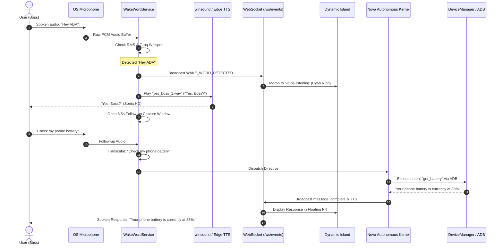

# Chapter 12: Full-Duplex Voice Pipeline Orchestration

## 1. Architectural Overview

The Voice Pipeline is the central circulatory system of ADA Mark VII. It orchestrates the real-time feedback loop between:
1. Ambient OS microphone listening.
2. Synchronous verbal acknowledgement in Sonia HD studio voice (*"Yes, Boss?"*).
3. Dynamic Island state morphing via WebSocket events (`/ws/events`).
4. Spoken directive parsing and cognitive task decomposition.
5. Autonomous capability routing and execution across Windows and Android.
6. Oral briefing synthesis and TTS response generation.



---

## 2. Two-Step Conversational Wake Flow

To deliver a natural, executive conversational experience and eliminate false triggers, ADA supports two distinct interaction modes:

### Mode A: Conversational Two-Step (Standard)
1. **User Utterance**: *"Hey ADA"*
2. **Immediate Aural Acknowledgement**: The daemon selects a natural pre-rendered British studio response:
   - *"Yes, Boss?"* (`yes_boss_1.wav`)
   - *"Yeah, Boss?"* (`yes_boss_2.wav`)
   - *"At your service, Boss."* (`yes_boss_3.wav`)
   - *"I'm here, Boss."* (`yes_boss_4.wav`)
   - *"Listening, Boss."* (`yes_boss_5.wav`)
3. **UI Expansion**: Dynamic Island morphs from compact pill (`220x36px`) to the expanded active listening state with oscillating audio spectrum rings.
4. **Follow-up Active Window**: The microphone captures the user's command over a 6.5-second timeout window (supporting up to 12.0 seconds of sustained speech).
5. **Execution**: The directive is transcribed, validated, and dispatched to the Nova Kernel.

### Mode B: Single-Breath Continuous Directive
When the user speaks a compound directive in one continuous breath (e.g., *"Hey ADA, what is my phone battery?"*):
1. The regex captures `"Hey ADA"` as the wake phrase and extracts `"what is my phone battery"` as the trailing directive.
2. The system speaks the acknowledgement (*"Yes, Boss?"*).
3. Recognizing that a valid directive with $\ge 2$ words is already present, ADA dispatches it immediately to the Kernel without requiring the user to speak a second time.

---

## 3. Acoustic Self-Trigger Prevention (`set_speaking`)

A common flaw in voice assistants is acoustic loopback: when the AI speaks through the host speakers, its own microphone picks up the audio output, interpreting its own voice as user speech.

ADA prevents this through explicit speaking state mutex flags:
```python
def set_speaking(self, speaking: bool):
    """Pauses listener while ADA speaks to prevent acoustic self-triggering."""
    self.is_speaking = speaking
    app_logger.debug(f"[WakeWord] Speaking state set to: {speaking}")
```

1. **Before TTS Playback**: `set_speaking(True)` is invoked.
2. **During TTS**: The background listening loop yields with `time.sleep(0.15)` and drops any audio packets.
3. **Post Playback Buffer**: After playback completes, the thread waits for a safety buffer (`time.sleep(0.18)`) for physical room echoes to dissipate before calling `set_speaking(False)`.

---

## 4. WebSocket Synchronization Protocol

The voice engine coordinates UI states through the `/ws/events` channel:

| Event Type | Payload | Frontend Action |
| :--- | :--- | :--- |
| `WAKE_WORD_DETECTED` | `{ wake_phrase: "Hey Ada", oral_response: "Yes, Boss?" }` | Expands Dynamic Island, triggers glowing cyan aura, plays sound waveform. |
| `WAKE_WORD_LISTENING` | `{ message: "Listening to you, Boss..." }` | Displays active transcription pulse and mic icon. |
| `RESPONSE_COMPLETED` | `{}` | Reverts Dynamic Island to compact idle state (`idle`). |
| `DIRECTIVE_DISPATCHED` | `{ directive: "Open Spotify" }` | Logs directive to Directive Stream HUD and executes. |

---

## 5. Persona & Neural Voice Engine: Sonia HD

ADA's vocal persona is calibrated to exude effortless British executive competence:
- **Provider**: Microsoft Edge Neural TTS / Local Pre-Rendered Audio Master
- **Voice**: `en-GB-SoniaNeural`
- **Rate**: `+0%` (Natural conversational cadence)
- **Pitch**: `+0Hz` (Crisp, studio-grade presence)
- **Audio Output**: 24kHz 16-bit Mono MP3 / WAV via Windows DirectSound
